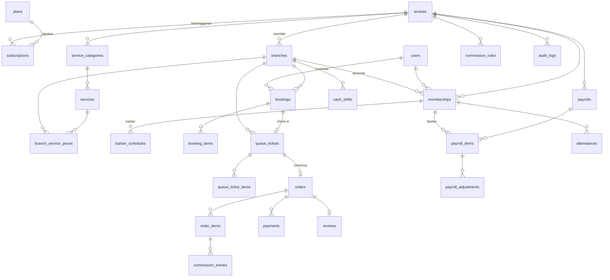
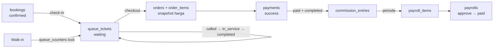

# DATABASE.md — Skema Database Barbershop SaaS

> Single database, multi-tenant via kolom `tenant_id`. MySQL 8 (kompatibel PostgreSQL).
> Konvensi: PK `id` (bigint), timestamps `created_at/updated_at`, uang = `unsignedBigInteger` (rupiah), soft delete pada master data.

---

## 1. ERD Ringkas

## 2. Pengelompokan Tabel

| Grup | Tabel |
|---|---|
| Platform | `plans`, `plan_features`, `tenants`, `subscriptions`, `subscription_invoices` |
| Akses | `users`, `memberships`, `customer_profiles` |
| Master | `branches`, `service_categories`, `services`, `branch_service_prices` |
| Jadwal | `barber_schedules`, `barber_time_offs`, `attendances` |
| Operasional | `bookings`, `booking_items`, `queue_counters`, `queue_tickets`, `queue_ticket_items`, `queue_ticket_events` |
| Transaksi | `orders`, `order_items`, `payments`, `cash_shifts` |
| Payroll | `salary_schemes`, `commission_rules`, `commission_entries`, `payrolls`, `payroll_items`, `payroll_adjustments` |
| Customer | `reviews`, `notifications` (bawaan Laravel) |
| Sistem | `audit_logs`, `settings` |

---

## 3. Detail Tabel

### 3.1 Platform

**plans**
| Kolom | Tipe | Keterangan |
|---|---|---|
| id | bigint PK | |
| code | string unique | `starter`, `pro`, `business` |
| name | string | |
| price_monthly | ubigint | Rupiah |
| max_branches | uint null | null = tak terbatas |
| max_staff | uint null | |
| is_active | bool | |

**plan_features** — `id, plan_id FK, feature_key (payroll, whatsapp, branding, subdomain), value (json/string)`

**tenants**
| Kolom | Tipe | Keterangan |
|---|---|---|
| id | bigint PK | |
| name | string | Nama barbershop |
| slug | string unique | URL `/{slug}` / subdomain |
| owner_user_id | FK users | |
| logo_path, brand_color | string null | White-label |
| phone, email, address | string null | |
| timezone | string | default `Asia/Jakarta` |
| status | enum | `trial`, `active`, `suspended`, `cancelled` |
| trial_ends_at | datetime null | |
| settings | json | aturan antrean, izin refund kasir, dsb. |

**subscriptions** — `id, tenant_id, plan_id, status (trialing|active|past_due|cancelled|expired), starts_at, ends_at, price (snapshot), auto_renew`

**subscription_invoices** — `id, tenant_id, subscription_id, number unique, amount, status (unpaid|paid|void), due_at, paid_at, gateway, gateway_ref`

### 3.2 Akses

**users** (global, tanpa tenant_id)
| Kolom | Tipe | Keterangan |
|---|---|---|
| id | bigint PK | |
| name | string | |
| email | string unique null | |
| phone | string unique null | Login customer / OTP |
| password | string null | null jika login Google/OTP |
| avatar_path | string null | |
| is_superadmin | bool | |
| google_id | string null | |
| last_login_at | datetime null | |

**memberships** — relasi user ↔ tenant ↔ cabang ↔ role
| Kolom | Tipe | Keterangan |
|---|---|---|
| id | bigint PK | |
| tenant_id | FK | |
| user_id | FK | |
| branch_id | FK null | null = semua cabang (owner) |
| role | enum | `owner`, `admin`, `barber` |
| display_name | string null | Nama panggilan barber |
| employment_type | enum null | `permanent`, `contract`, `freelance` |
| salary_scheme_id | FK null | |
| work_status | enum | `active`, `break`, `off` (real-time barber) |
| permissions | json null | izin tambahan (mis. `can_refund`) |
| is_active | bool | |
| joined_at | date null | |
| unique | (tenant_id, user_id, branch_id, role) | |

**customer_profiles** — data customer per tenant: `id, tenant_id, user_id null, name, phone, notes (preferensi gaya), visit_count, total_spent, last_visit_at, points` · unique `(tenant_id, phone)`.
> Walk-in tanpa akun tetap tercatat via `customer_profiles` (user_id null).

### 3.3 Master Data

**branches**
| Kolom | Tipe | Keterangan |
|---|---|---|
| id, tenant_id | | |
| name, code | string | code untuk prefix nomor (mis. `SDR`) |
| address, phone, lat, lng | | |
| opening_hours | json | `{mon:{open:"10:00",close:"21:00"},...}` |
| late_tolerance_minutes | uint | default 15 |
| booking_slot_minutes | uint | default 15 |
| allow_customer_choose_barber | bool | |
| qr_token | string unique | link ambil antrean |
| is_active | bool | |

**service_categories** — `id, tenant_id, name, sort_order`

**services**
| Kolom | Tipe | Keterangan |
|---|---|---|
| id, tenant_id, service_category_id | | |
| name, description | | |
| price | ubigint | harga default |
| duration_minutes | uint | |
| is_commissionable | bool | |
| type | enum | `service`, `product` |
| image_path | null | |
| is_active, sort_order | | |

**branch_service_prices** — override harga per cabang: `id, tenant_id, branch_id, service_id, price, is_available` · unique `(branch_id, service_id)`

### 3.4 Jadwal & Absensi

**barber_schedules** — `id, tenant_id, branch_id, membership_id, day_of_week (0–6), start_time, end_time, break_start null, break_end null`

**barber_time_offs** — `id, tenant_id, membership_id, date_from, date_to, type (leave|sick|off), reason, approved_by null`

**attendances**
| Kolom | Tipe | Keterangan |
|---|---|---|
| id, tenant_id, branch_id, membership_id | | |
| date | date | unique (membership_id, date) |
| check_in_at, check_out_at | datetime null | |
| check_in_lat/lng, photo_path | null | opsional |
| status | enum | `present`, `late`, `absent`, `leave` |
| late_minutes | uint | |

### 3.5 Operasional (Booking & Antrean)

**bookings**
| Kolom | Tipe | Keterangan |
|---|---|---|
| id, tenant_id, branch_id | | |
| code | string unique | `BK-20261027-0012` |
| customer_profile_id | FK | |
| user_id | FK null | jika customer login |
| barber_membership_id | FK null | null = siapa saja |
| scheduled_at | datetime | index (branch_id, scheduled_at) |
| estimated_end_at | datetime | dari total durasi |
| total_duration_minutes | uint | |
| estimated_total | ubigint | |
| status | enum | `pending`, `confirmed`, `checked_in`, `completed`, `cancelled`, `no_show`, `expired` |
| source | enum | `customer_app`, `admin`, `whatsapp` |
| notes | text null | |
| cancelled_at, cancel_reason, cancelled_by | null | |

**booking_items** — `id, booking_id, service_id, service_name (snapshot), price (snapshot), duration_minutes`

**queue_counters** — generator nomor aman
| Kolom | Tipe | Keterangan |
|---|---|---|
| id, tenant_id, branch_id | | |
| date | date | |
| prefix | char(2) | `A` walk-in, `B` booking |
| last_number | uint | di-`lockForUpdate` lalu +1 |
| unique | (branch_id, date, prefix) | |

**queue_tickets** — inti antrean
| Kolom | Tipe | Keterangan |
|---|---|---|
| id, tenant_id, branch_id | | |
| date | date | |
| number | string | `A-012`; unique (branch_id, date, number) |
| sequence | uint | urutan |
| booking_id | FK null unique | |
| customer_profile_id | FK | |
| barber_membership_id | FK null | barber ditugaskan |
| requested_barber_id | FK null | pilihan customer |
| type | enum | `walk_in`, `booking` |
| status | enum | `waiting`, `called`, `in_service`, `completed`, `cancelled`, `no_show` |
| priority_at | datetime | dipakai untuk urutan gabungan (booking = jam booking, walk-in = waktu ambil) |
| estimated_duration_minutes | uint | |
| called_at, started_at, completed_at | datetime null | |
| skip_count | tinyint | |
| version | uint | optimistic lock |
| index | (branch_id, date, status, priority_at) | |

**queue_ticket_items** — layanan yang dipilih: `id, queue_ticket_id, service_id, service_name, price, duration_minutes`

**queue_ticket_events** — riwayat status: `id, queue_ticket_id, from_status, to_status, actor_user_id, created_at`

### 3.6 Transaksi

**orders**
| Kolom | Tipe | Keterangan |
|---|---|---|
| id, tenant_id, branch_id | | |
| number | string unique | `INV-SDR-20261027-0008` |
| queue_ticket_id | FK null unique | |
| customer_profile_id | FK null | |
| barber_membership_id | FK null | barber utama |
| cashier_user_id | FK | |
| cash_shift_id | FK null | |
| subtotal | ubigint | |
| discount_total | ubigint | |
| tip_amount | ubigint | untuk barber, bukan basis komisi |
| grand_total | ubigint | |
| paid_total, refunded_total | ubigint | |
| payment_status | enum | `unpaid`, `paid`, `partially_refunded`, `refunded`, `void` |
| idempotency_key | string unique | cegah submit ganda |
| paid_at | datetime null | |
| notes | text null | |

**order_items** — snapshot harga & komisi
| Kolom | Tipe | Keterangan |
|---|---|---|
| id, order_id, tenant_id | | |
| service_id | FK null | |
| barber_membership_id | FK null | bisa beda per item |
| name | string | snapshot |
| type | enum | `service`, `product` |
| qty | uint | |
| unit_price | ubigint | snapshot |
| discount | ubigint | |
| line_total | ubigint | |
| commission_rule_snapshot | json null | aturan saat transaksi |

**payments**
| Kolom | Tipe | Keterangan |
|---|---|---|
| id, tenant_id, order_id | | |
| type | enum | `payment`, `refund` |
| method | enum | `cash`, `qris`, `transfer`, `ewallet`, `card` |
| amount | ubigint | |
| cash_received, change_amount | ubigint null | tunai |
| reference | string null | no. ref QRIS/transfer |
| status | enum | `pending`, `success`, `failed` |
| received_by | FK users | |
| reason | text null | wajib untuk refund |
| idempotency_key | string unique | |

**cash_shifts** — `id, tenant_id, branch_id, cashier_user_id, opened_at, closed_at null, opening_cash, expected_cash, counted_cash, difference, notes`

### 3.7 Payroll & Komisi

**salary_schemes**
| Kolom | Tipe | Keterangan |
|---|---|---|
| id, tenant_id, name | | |
| type | enum | `base_only`, `commission_only`, `base_plus_commission` |
| base_salary | ubigint | per bulan |
| period | enum | `monthly`, `biweekly`, `weekly` |
| target_bonus_rules | json null | `[{min_services:250,bonus:200000},{min_services:300,bonus:300000}]` |

**commission_rules**
| Kolom | Tipe | Keterangan |
|---|---|---|
| id, tenant_id | | |
| scope | enum | `global`, `service`, `category` |
| service_id / service_category_id | FK null | |
| membership_id | FK null | override per barber |
| type | enum | `flat`, `percentage` |
| value | ubigint/decimal | Rp5.000 atau 30 (%) |
| priority | uint | barber+service > service > category > global |
| effective_from, effective_to | date null | |

**commission_entries** — buku besar komisi (append-only)
| Kolom | Tipe | Keterangan |
|---|---|---|
| id, tenant_id, branch_id | | |
| membership_id | FK | barber |
| order_item_id | FK | |
| type | enum | `commission`, `reversal`, `tip` |
| base_amount | bigint | |
| amount | bigint | negatif untuk reversal |
| earned_at | datetime | |
| payroll_id | FK null | terisi saat masuk payroll |

**payrolls** — `id, tenant_id, branch_id null, period_start, period_end, status (draft|pending_approval|approved|paid|closed), approved_by, approved_at, paid_at, total_amount`

**payroll_items**
| Kolom | Tipe | Keterangan |
|---|---|---|
| id, payroll_id, tenant_id, membership_id | | |
| services_count | uint | |
| base_salary | ubigint | |
| commission_total | bigint | |
| bonus_total, deduction_total, tip_total | bigint | |
| gross_total, net_total | bigint | |
| scheme_snapshot | json | |
| payment_status | enum | `unpaid`, `paid` |
| paid_at, payment_method, payment_reference | null | |

**payroll_adjustments** — `id, payroll_item_id, type (bonus|deduction), label (Kasbon, Denda telat, Bonus target), amount, notes, created_by`

### 3.8 Customer Experience

**reviews** — `id, tenant_id, branch_id, order_id unique, customer_profile_id, barber_membership_id, rating (1–5), comment, is_published, replied_text, replied_at`

### 3.9 Sistem

**audit_logs**
| Kolom | Tipe | Keterangan |
|---|---|---|
| id | bigint | |
| tenant_id | FK null | null = aksi platform |
| user_id | FK null | |
| action | string | `order.refunded`, `service.price_updated`, `payroll.approved` |
| auditable_type, auditable_id | morph | |
| old_values, new_values | json null | |
| ip_address, user_agent | null | |
| created_at | datetime | |

**settings** — `id, tenant_id null, key, value json` (konfigurasi platform & tenant)

---

## 4. Contoh Alur Data

## 5. Indeks & Constraint Penting
- Setiap tabel bisnis: index `tenant_id`, dan composite `(tenant_id, branch_id, ...)` untuk query laporan.
- `queue_tickets`: unique `(branch_id, date, number)`; index `(branch_id, date, status, priority_at)`.
- `bookings`: index `(branch_id, barber_membership_id, scheduled_at)` untuk cek slot bentrok.
- `orders.idempotency_key`, `payments.idempotency_key`: unique.
- `orders.queue_ticket_id`: unique (1 tiket = 1 order).
- `commission_entries`: tidak pernah di-update/delete — koreksi via `reversal`.
- Foreign key `restrictOnDelete` untuk data transaksi; master data memakai soft delete.

## 6. Urutan Migrasi
1. `plans`, `plan_features`
2. `users` (modifikasi bawaan), `tenants`, `subscriptions`, `subscription_invoices`
3. `branches`, `salary_schemes`, `memberships`, `customer_profiles`
4. `service_categories`, `services`, `branch_service_prices`
5. `barber_schedules`, `barber_time_offs`, `attendances`
6. `bookings`, `booking_items`, `queue_counters`, `queue_tickets`, `queue_ticket_items`, `queue_ticket_events`
7. `cash_shifts`, `orders`, `order_items`, `payments`
8. `commission_rules`, `payrolls`, `payroll_items`, `commission_entries`, `payroll_adjustments`
9. `reviews`, `audit_logs`, `settings`
