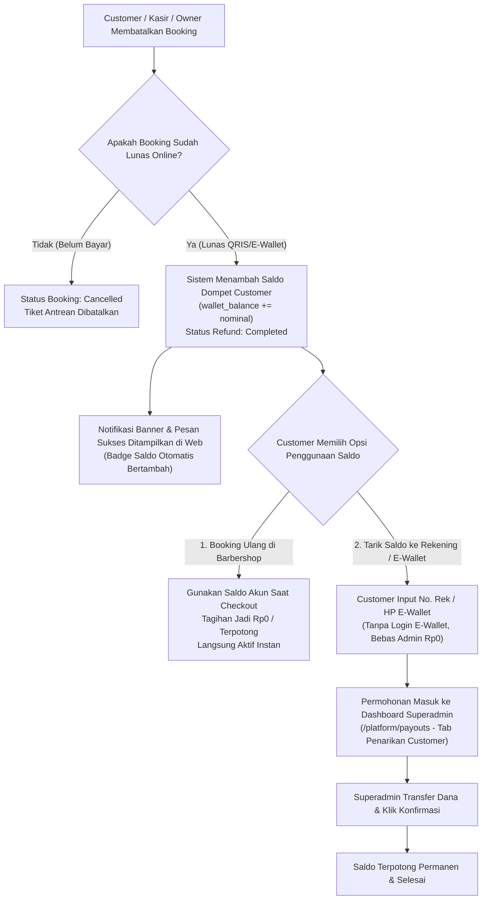

# PLAN-CUSTOMER-REFUND-WALLET-ESCROW.md — Rencana Sistem Saldo Dompet Refund Customer & Penarikan Dana (Escrow)

> **Status:** Completed / Selesai Diimplementasikan & Lulus Uji Test  
> **Tujuan:** Mengintegrasikan sistem **Saldo Dompet Akun Customer (Customer Wallet / Credit Balance)** untuk pengembalian dana (*refund*) booking secara instan dan 100% otomatis tanpa biaya admin, serta menyediakan antarmuka **Penarikan Saldo (Withdrawal)** ke rekening bank / e-wallet customer yang diproses terpusat oleh Superadmin dengan biaya admin gratis (Rp0).

---

## 1. Latar Belakang & Analisis Masalah

1. **Kondisi Saat Ini:**
   - Pembayaran booking ditampung terpusat di akun Xendit Superadmin (Platform Escrow).
   - Jika booking dibatalkan dan kasir/owner mengklik "Konfirmasi Refund", saldo payout barbershop menjadi Rp0.
   - Jika Kasir/Owner mentransfer uang refund ke customer dari kantong/rekening pribadi barbershop, **barbershop tekor**, karena uang asli dari customer masih mengendap di akun Superadmin.
   - Jika menggunakan *Auto-Disbursement API* Xendit untuk setiap refund, Superadmin terkena biaya transfer antar-bank (~Rp5.550 per transaksi), yang sangat merugikan untuk transaksi barbershop bernilai Rp30.000–Rp70.000.

2. **Solusi Standar Industri (Opsi B):**
   - **Saldo Dompet Akun Customer (Store Credit):** Dana refund otomatis langsung masuk ke Saldo Akun Customer di aplikasi barbershop (instan, nol biaya admin, customer tidak bingung dan dijamin kembali booking).
   - **Penarikan Saldo Tunai (Withdrawal Request):** Jika customer tidak ingin booking lagi dan ingin uang tunai, customer dapat mengajukan penarikan dana ke rekening bank / e-wallet (DANA, OVO, GoPay, BCA, dll) **tanpa perlu login akun e-wallet**, cukup memasukkan nomor rekening/nomor HP e-wallet.
   - **Bebas Biaya Admin (Rp0):** Penarikan dana disetel gratis tanpa potongan agar customer merasa aman dan terpercaya, diproses transfer oleh Superadmin dari saldo penampung platform.
   - **Pemberitahuan Langsung di Web:** Menampilkan banner notifikasi hijau dan status informatif di halaman riwayat booking serta dashboard customer (tanpa perlu membuka WhatsApp).

---

## 2. Arsitektur Alur Kerja (Workflow)

---

## 3. Rencana Perubahan Basis Data (Database Schema)

### 3.1 Penambahan Kolom Saldo di Tabel Customer
File: `database/migrations/xxxx_add_wallet_balance_to_customer_profiles_and_users_table.php`
- `customer_profiles`:
  - `wallet_balance` (`unsignedBigInteger`, default `0`)
- `users`:
  - `wallet_balance` (`unsignedBigInteger`, default `0`)

### 3.2 Tabel Riwayat Mutasi Dompet (`customer_wallet_transactions`)
Mencatat seluruh aliran masuk dan keluar saldo customer secara append-only:
- `id` (bigIncrements)
- `user_id` (foreignId -> users, nullable)
- `customer_profile_id` (foreignId -> customer_profiles, nullable)
- `tenant_id` (foreignId -> tenants, nullable)
- `type` (`enum: 'credit', 'debit'`)
- `category` (`enum: 'refund_booking', 'booking_payment', 'withdrawal', 'adjustment'`)
- `amount` (`unsignedBigInteger`)
- `balance_before` (`unsignedBigInteger`)
- `balance_after` (`unsignedBigInteger`)
- `reference_id` (`string`, nullable — contoh no booking `BK-xxx` atau kode withdrawal `WD-xxx`)
- `notes` (`text`, nullable)
- `timestamps`

### 3.3 Tabel Permohonan Penarikan Saldo (`customer_withdrawals`)
- `id` (bigIncrements)
- `withdrawal_code` (`string`, unique — contoh `WD-20261106-ABCD`)
- `user_id` (foreignId -> users)
- `customer_profile_id` (foreignId -> customer_profiles, nullable)
- `amount` (`unsignedBigInteger` — nominal yang ditarik)
- `admin_fee` (`unsignedBigInteger`, default `0` — Bebas Biaya Admin)
- `net_amount` (`unsignedBigInteger` — nominal bersih diterima customer)
- `bank_name` (`string` — BCA, Mandiri, BRI, DANA, OVO, GoPay, ShopeePay, dll)
- `account_number` (`string` — No. Rekening Bank atau No. HP E-Wallet)
- `account_holder` (`string` — Nama Lengkap Pemilik Rekening)
- `status` (`enum: 'pending', 'processing', 'completed', 'rejected'`, default `'pending'`)
- `proof_path` (`string`, nullable — foto/file bukti transfer Superadmin)
- `rejection_reason` (`text`, nullable)
- `processed_by` (`foreignId -> users`, nullable)
- `processed_at` (`datetime`, nullable)
- `timestamps`

---

## 4. Rencana Modifikasi Logika & Backend Service

### 4.1 `CustomerWalletService` (Service Baru)
Membuat service `app/Services/CustomerWalletService.php`:
1. `credit(User|CustomerProfile $target, int $amount, string $category, ?string $referenceId = null, ?string $notes = null, ?int $tenantId = null): CustomerWalletTransaction`:
   - Melakukan penambahan saldo secara atomic (`lockForUpdate` + `DB::transaction`).
   - Mencatat ke log `customer_wallet_transactions`.
2. `debit(User|CustomerProfile $target, int $amount, string $category, ?string $referenceId = null, ?string $notes = null, ?int $tenantId = null): CustomerWalletTransaction`:
   - Validasi saldo mencukupi.
   - Mengurangi saldo secara atomic.
   - Mencatat ke log `customer_wallet_transactions`.
3. `createWithdrawalRequest(User $user, int $amount, string $bankName, string $accountNumber, string $accountHolder): CustomerWithdrawal`:
   - Mengurangi saldo customer sementara (hold/debit).
   - Menerbitkan tiket permohonan penarikan berstatus `pending`.

### 4.2 Integrasi Pembatalan Booking (`CustomerPortalController` & `OperationalActionController`)
- Saat customer atau kasir/owner membatalkan booking yang berstatus `xendit_paid_at != null`:
  - Panggil `CustomerWalletService::credit()` sebesar nilai `estimated_total`.
  - Update `refund_status = 'completed'`, `refund_amount = $amount`, `refunded_at = now()`.
  - Tampilkan banner notifikasi hijau dan status informatif di web customer.
  - Barbershop **tidak tekor**, uang tetap aman di rekening Superadmin.

### 4.3 Integrasi Checkout Booking dengan Saldo Dompet
- Di form reservasi booking customer (`CustomerPortalController::storeBooking`):
  - Jika customer memiliki `wallet_balance > 0`, sistem menyediakan opsi toggle / otomatis menggunakan saldo.
  - Jika saldo menutupi seluruh tagihan: booking langsung lunas (`PaymentStatus::Paid`), antrean langsung terbit tanpa membuat tagihan Xendit.
  - Jika saldo hanya menutupi sebagian: saldo dipotong terlebih dahulu, sisa kekurangan diterbitkan tagihan Xendit QRIS / E-Wallet.

### 4.4 Dashboard Superadmin (`PlatformPayoutController`)
- Di halaman `resources/views/platform/payouts/index.blade.php`:
  - Tambahkan Tab 2: **"Penarikan Saldo Customer (Withdrawals)"**.
  - Tampilkan tabel antrean permohonan penarikan dana customer:
    - Kode WD, Tanggal Pengajuan, Nama Customer, Bank/E-Wallet Tujuan, No. Rekening/HP, Nominal (Rp), Status, Aksi.
  - Tombol Aksi:
    - **"Selesaikan Penarikan (Tandai Ditransfer)"**: Upload bukti transfer opsional, ubah status `completed`.
    - **"Tolak Penarikan"**: Masukkan alasan penolakan, saldo otomatis dikembalikan (*refund reversal*) ke akun customer.

---

## 5. Rencana Perubahan Antarmuka (UI/UX)

1. **Dashboard & Header Customer (`resources/views/dashboards/customer.blade.php` & `profile.blade.php`):**
   - Kartu Dompet Saya: Menampilkan badge saldo mencolok (contoh: `💰 Saldo: Rp50.000`).
   - Tombol *"Tarik Saldo"* yang membuka modal dialog penarikan dana.
   - Tabel riwayat mutasi saldo (Kredit masuk dari pembatalan booking, Debit keluar untuk booking baru / penarikan).
2. **Modal Tarik Saldo Customer:**
   - Dropdown pilihan: BCA, Mandiri, BRI, BNI, DANA, GoPay, OVO, ShopeePay, LinkAja.
   - Input No. Rekening / No. HP E-Wallet.
   - Input Nama Pemilik Rekening.
   - Keterangan informatif: *"Bebas Biaya Admin (Gratis Rp0) — Diproses oleh Admin Platform dalam 1x24 jam."*
3. **Pemberitahuan Status Pembatalan di Web:**
   - Banner notifikasi hijau pada halaman detail booking: *"Pembatalan Berhasil! Dana Rp50.000 telah masuk ke Saldo Akun Anda dan siap digunakan kembali."*

---

## 6. Tahapan Pelaksanaan (Step-by-Step Execution Plan)

- [x] **Step 1:** Buat migrasi database penambahan kolom `wallet_balance` dan tabel `customer_wallet_transactions` & `customer_withdrawals`. Jalankan `php artisan migrate`.
- [x] **Step 2:** Buat Model `CustomerWalletTransaction` dan `CustomerWithdrawal` lengkap dengan relasi Eloquent.
- [x] **Step 3:** Buat service `CustomerWalletService` untuk mengelola atomic credit/debit dan request penarikan.
- [x] **Step 4:** Hubungkan alur pembatalan booking di `CustomerPortalController` dan `OperationalActionController` agar otomatis mengkreditkan saldo ke akun customer saat dibatalkan.
- [x] **Step 5:** Perbarui alur checkout booking di `CustomerPortalController` agar mendukung pembayaran menggunakan Saldo Dompet (baik lunas penuh maupun sebagian).
- [x] **Step 6:** Buat antarmuka Customer (Widget Saldo, Riwayat Mutasi, Modal Tarik Saldo, dan Banner Notifikasi Web).
- [x] **Step 7:** Buat antarmuka Superadmin di `platform/payouts` (Tab Penarikan Saldo Customer) untuk memverifikasi dan menyelesaikan transfer.
- [x] **Step 8:** Buat Automated Feature Test (`tests/Feature/CustomerRefundWalletTest.php`) untuk memastikan seluruh alur (refund ke dompet -> booking pakai saldo -> tarik dana -> approval Superadmin) lulus 100%.

---

## 7. Verifikasi & Kriteria Keberhasilan

1. **Keamanan Finansial:** Barbershop tidak pernah tekor saat ada pembatalan booking online.
2. **Biaya Admin Rp0:** Saldo masuk utuh dan penarikan tidak dipotong biaya apa pun.
3. **Kepraktisan Customer:** Customer tidak perlu login e-wallet luar untuk menarik saldo; cukup ketik nomor rekening / no. HP e-wallet.
4. **Keutuhan Data:** Seluruh saldo tercatat dengan snapshot `balance_before` dan `balance_after` (tidak ada manipulasi saldo siluman).
