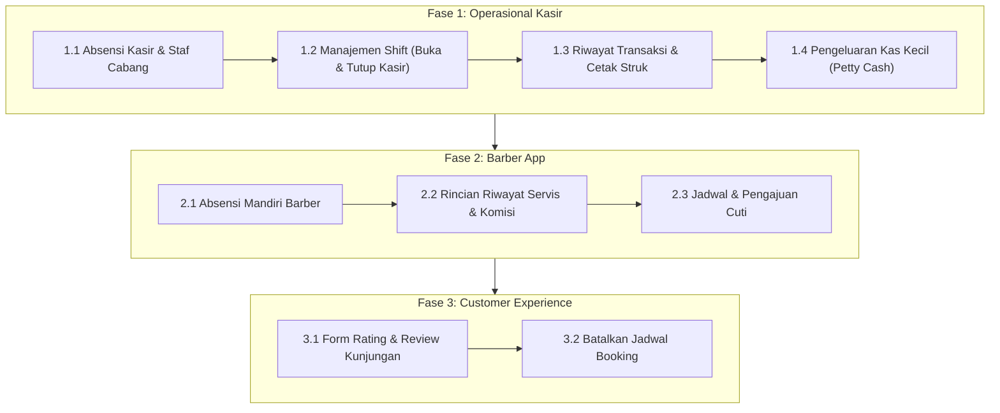

# PLAN-KASIR-BARBER-CUSTOMER.md — Rencana Pengembangan Fitur Operasional

> Dokumen perencanaan detail untuk melengkapi fitur operasional harian yang belum terhubung atau belum tersedia pada sisi **Kasir (Admin)**, **Barber (Staff)**, dan **Customer (Pelanggan)**.
> 
> Tanggal dibuat: 30 Oktober 2026  
> Urutan Pengerjaan: **Kasir** ➔ **Barber** ➔ **Customer**

---

## 1. Analisis Gap & Status Saat Ini

Meskipun fondasi tabel database, routing dasar, dan controller utama telah dibangun, terdapat celah (*gap*) operasional nyata yang belum terhubung pada antarmuka masing-masing peran:

| Peran | Yang Sudah Ada | Yang Masih Kurang / Belum Terhubung |
|---|---|---|
| **Kasir (Admin)** | • Papan antrean POS (`/cashier`) • Input walk-in & check-in booking • Transisi tiket & proses checkout bayar • Monitor status kursi barber | ❌ **Absensi:** Kasir tidak bisa absen masuk/pulang sendiri & memverifikasi kehadiran barber cabang. ❌ **Cash Shift (Laci Kasir):** Buka Kasir (modal awal) & Tutup Kasir (rekonsiliasi fisik uang tunai) belum ada antarmuka/alirannya. ❌ **Riwayat & Struk:** Belum ada daftar transaksi hari ini & cetak struk kasir thermal (58mm/80mm). ❌ **Petty Cash:** Belum ada pencatatan pengeluaran kas kecil operasional outlet. |
| **Barber (Staff)** | • Dashboard antrean pribadi (`/barber`) • Panggil tiket, mulai, & selesaikan servis • Toggle status kerja (Active/Break/Off) • Ringkasan nominal komisi hari ini | ❌ **Absensi Mandiri:** Belum ada tombol resmi Clock In / Clock Out yang terhubung ke tabel `attendances` & payroll. ❌ **Breakdown Komisi:** Hanya melihat total nominal, belum ada rincian pelanggan & layanan apa saja yang dikerjakan. ❌ **Jadwal & Cuti:** Tidak bisa melihat jadwal shift mingguan & mengajukan izin/cuti sakit. |
| **Customer** | • Portal booking & antrean online (`/b/{tenant}`) • Cek status tiket real-time • Riwayat kunjungan & profil akun | ❌ **Ulasan / Review:** Tabel `reviews` dan panel moderasi di superadmin sudah ada, tapi belum ada form bintang & review dari pelanggan. ❌ **Batalkan Booking:** Belum ada tombol pembatalan booking mandiri bagi pelanggan. |

---

## 2. Roadmap Pengerjaan: Sisi Kasir (Prioritas 1)

Pengerjaan akan difokuskan secara bertahap pada sisi kasir terlebih dahulu agar operasional fisik di outlet berjalan utuh dan rapi.

---

### Tahap 1.1: Absensi Kasir & Monitoring Kehadiran Staf Cabang (SELESAI ✅)
* **Tujuan:** Kasir dan Barber dapat mencatat kehadirannya secara mandiri melalui pemindaian QR Code meja kasir yang divalidasi dengan radius GPS (Haversine formula), serta memantau jadwal dan kehadiran staf cabang.
* **Komponen yang Dibuat & Diimplementasikan:**
  1. **Pengaturan QR Standee Cabang (Owner):**
     - Generator QR Token Cabang di menu Jadwal Owner (`/owner/schedule-settings`).
     - Fitur Cetak Standee Akrilik Meja (`@media print`) dan Download QR sebagai file PNG murni (`qrcode.min.js`).
     - Fitur Reset/Regenerasi Token QR cabang jika bocor.
  2. **Halaman Khusus Absensi & Jadwal Kerja (`/cashier/attendance` & `/barber/attendance`):**
     - Sesuai arahan, absensi dipisahkan ke halaman sendiri agar dashboard operasional utama kasir/barber tetap bersih dan fokus pada antrean/POS tanpa banner pengingat yang mengganggu.
     - Status kehadiran hari ini (Jam masuk, status tepat waktu/terlambat, jam pulang).
     - Kalender jadwal shift mingguan (Senin - Minggu dengan badge hari ini).
     - Monitoring kehadiran barber cabang hari ini (khusus kasir).
     - Riwayat absensi 14 hari terakhir.
  3. **Pemindaian QR Kamera & Validasi GPS Real-time:**
     - Pemindai kamera HTML5 langsung dari browser berorientasi *square* (`aspect-square`) dengan target *bracket* 4 sudut dan garis laser pemindai.
     - Wajib pemindaian QR (tanpa jalan pintas/bypass link).
     - Validasi koordinat GPS perangkat staf dengan koordinat cabang menggunakan rumus *Haversine* pada backend (`AttendanceScanController`). Ditolak otomatis jika di luar batas radius outlet.
* **Endpoint & Route:**
  - `GET /attend/{token}` (Tampilan konfirmasi scan & verifikasi jarak GPS)
  - `POST /attend/{token}` (Pencatatan Masuk/Pulang validasi GPS)
  - `GET /cashier/attendance` (Halaman mandiri absensi & jadwal kasir)
  - `GET /barber/attendance` (Halaman mandiri absensi & jadwal barber)
  - `POST /owner/schedule-settings/regenerate-qr` (Reset token QR cabang)

---

### Tahap 1.2: Manajemen Shift Kasir (Buka & Tutup Kasir / Cash Shift)
* **Tujuan:** Menghindari kebocoran kas, mencatat modal awal kasir, dan rekonsiliasi uang fisik saat pergantian atau penutupan shift kasir.
* **Komponen yang Dibuat / Dihubungkan:**
  1. **Buka Kasir (Open Shift):**
     - Modal prompt saat kasir pertama kali mengakses POS jika belum ada shift aktif untuk cabang & kasir tersebut.
     - Input modal awal kas / uang kembalian (misal: Rp 200.000).
     - Membuat record di tabel `cash_shifts` dengan `opened_at` dan `opening_cash`.
  2. **Indikator Shift Aktif di POS:**
     - Menampilkan pill badge di dashboard kasir: Kasir Aktif, Jam Buka, Total Kas di Laci saat ini.
     - Setiap transaksi pembayaran tunai otomatis mengaitkan `orders.cash_shift_id` dengan shift yang sedang aktif.
  3. **Tutup Kasir & Rekonsiliasi (Close Shift):**
     - Modal rekap kasir: Menampilkan Ringkasan Penjualan Shift (Total Tunai, QRIS, Total Tip, Total Pengeluaran Kas Kecil).
     - Input `counted_cash`: Kasir menghitung fisik uang tunai di laci kas.
     - Sistem otomatis menghitung `difference` (Selisih lebih / kurang).
     - Catatan serah terima shift (`notes`) dan cetak ringkasan shift (*Shift Report*).
* **Endpoint & Route:**
  - `GET /cashier/shift/current`
  - `POST /cashier/shift/open`
  - `POST /cashier/shift/close`
  - `GET /cashier/shift/{shift}/summary`

---

### Tahap 1.3: Riwayat Transaksi Cabang Hari Ini & Cetak Struk Kasir
* **Tujuan:** Mempermudah kasir mengecek transaksi yang telah selesai hari ini, mencari invoice, dan mencetak struk fisik thermal.
* **Komponen yang Dibuat / Dihubungkan:**
  1. **Tab Riwayat Transaksi Kasir:**
     - Daftar invoice yang diselesaikan di cabang hari ini (nomor order, nama pelanggan, barber, layanan, total bayar, metode bayar).
  2. **Modal / View Cetak Struk Kasir (Thermal Receipt):**
     - Format cetak ramah kertas struk 58mm / 80mm:
       - Header nama barbershop, alamat cabang, nomor telepon.
       - Nomor order, tanggal & jam, nama kasir & barber.
       - Item layanan / produk, harga, diskon, tip.
       - Total, tunai diterima, kembalian.
       - Footer ucapan terima kasih & barcode/QR verifikasi.
     - Tombol langsung memanggil `window.print()` dengan CSS `@media print` terisolasi.
* **Endpoint & Route:**
  - `GET /cashier/transactions`
  - `GET /cashier/orders/{order}/receipt`

---

### Tahap 1.4: Pencatatan Pengeluaran Kas Kecil (Petty Cash Operasional)
* **Tujuan:** Kasir dapat mencatat pengeluaran operasional mendadak dari uang kas laci (misal: air mineral, laundry handuk, perlengkapan kebersihan).
* **Komponen yang Dibuat / Dihubungkan:**
  - Form catat pengeluaran (kategori, nominal, catatan/keperluan, lampiran foto opsional).
  - Mengurangi ekspektasi uang kas fisik pada saat tutup kasir (`expected_cash = opening_cash + cash_sales - petty_cash`).
* **Endpoint & Route:**
  - `POST /cashier/petty-cash`

---

## 3. Roadmap Pengerjaan: Sisi Barber (Prioritas 2)

Setelah sisi kasir matang, pengembangan berlanjut ke portal barber:

1. **Absensi Mandiri Barber:**
   - Tombol *Clock In* & *Clock Out* di header portal barber (`/barber`).
   - Validasi jam masuk berdasarkan jadwal kerja barber hari itu (`barber_schedules`).
2. **Breakdown Riwayat Servis & Komisi:**
   - Tab riwayat layanan yang sudah selesai dikerjakan hari ini (siapa pelanggannya, jenis cukur/treatment, nominal komisi per kepala).
3. **Jadwal Kerja & Pengajuan Cuti (Time Off):**
   - Halaman jadwal kerja mingguan barber.
   - Form pengajuan cuti/izin sakit dari barber ke owner barbershop.

---

## 4. Roadmap Pengerjaan: Sisi Customer (Prioritas 3)

Penyempurnaan pengalaman pelanggan publik di `/b/{tenant}`:

1. **Form Rating & Review:**
   - Setelah status tiket `completed`, customer dapat memberikan rating (1-5 bintang), tag kepuasan, dan ulasan singkat.
   - Terhubung langsung ke tabel `reviews` dan panel moderasi platform/owner.
2. **Pembatalan Mandiri Booking:**
   - Tombol batalkan booking pada halaman status booking customer sebelum batas waktu toleransi cabang.

---

## 5. Checklist Pelaksanaan

- [x] **Fase 1: Kasir**
  - [x] 1.1 Implementasi Absensi Kasir (QR Code Scan, Unduh PNG, Cetak Standee Poster, & Clock In/Out)
  - [ ] 1.2 Implementasi Buka & Tutup Kasir (Cash Shift Management)
  - [ ] 1.3 Implementasi Tab Riwayat Transaksi Kasir & Cetak Struk Kasir Thermal (58/80mm)
  - [ ] 1.4 Implementasi Kas Kecil (Petty Cash Operasional)
- [ ] **Fase 2: Barber**
  - [ ] 2.1 Implementasi Absensi Mandiri Barber
  - [ ] 2.2 Rincian Riwayat Servis & Komisi Barber
  - [ ] 2.3 Jadwal Kerja & Pengajuan Cuti Mandiri
- [ ] **Fase 3: Customer**
  - [ ] 3.1 Form Submit Rating & Review Pelanggan
  - [ ] 3.2 Tombol Pembatalan Booking Mandiri
