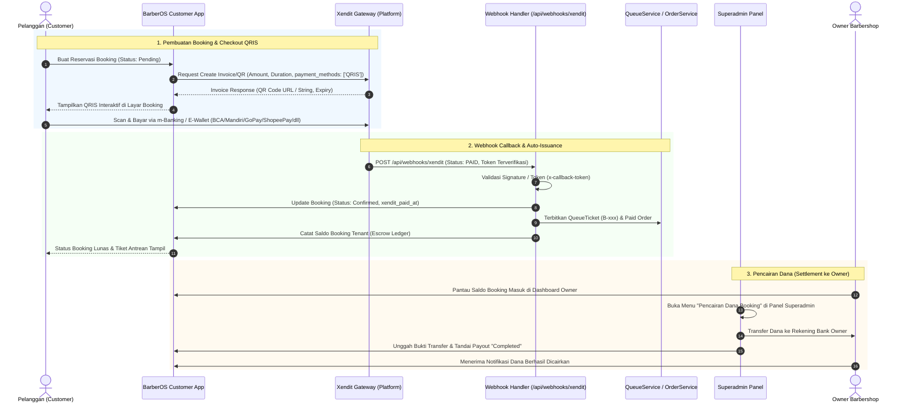

# PLAN-XENDIT-ESCROW-BOOKING.md — Rencana Integrasi Pembayaran Xendit & Pencairan Dana (Escrow)

> **Status:** Completed & Active  
> **Tujuan:** Mengganti alur pembayaran booking manual (transfer bank & upload bukti gambar) dengan gateway pembayaran otomatis menggunakan **Xendit eksklusif QRIS**, di mana pembayaran ditampung di rekening official platform (Superadmin) dan dicairkan (*disbursement / payout*) secara terpusat oleh Superadmin ke masing-masing Owner Barbershop (mendukung rekening bank maupun e-wallet).

---

## 1. Latar Belakang & Kebutuhan Bisnis

Sebelumnya, pembayaran booking mengharuskan pelanggan melakukan transfer manual ke nomor rekening masing-masing cabang/owner dan mengunggah foto bukti transfer. Alur ini memiliki beberapa kelemahan:
- Rentan kesalahan upload atau pemalsuan bukti transfer.
- Membebani kasir/sistem untuk melakukan verifikasi manual.
- Customer tidak mendapatkan kenyamanan pembayaran instan yang seragam.

### Prinsip Model Bisnis Baru:
1. **Satu Metode Pembayaran Instan: QRIS (National Standard):**
   - Menggunakan **1 metode pembayaran saja yaitu QRIS**.
   - Sangat fleksibel dan inklusif: pelanggan dapat memindai (*scan*) menggunakan aplikasi m-Banking apa saja (BCA, Mandiri, BRI, BNI, CIMB Niaga, dll) maupun E-Wallet apa saja (GoPay, OVO, DANA, ShopeePay, LinkAja).
   - Mengeliminasi kebingungan memilih channel bank / e-wallet yang rumit.
2. **Rekening Penampung Terpusat (*Platform Escrow*):**  
   Seluruh pembayaran booking online dari seluruh barbershop ditampung di akun Xendit QRIS milik Platform Official (Superadmin). Barbershop/Tenant tidak diwajibkan membuat akun payment gateway sendiri.
3. **Otomatisasi Seketika (*Instant Auto-Confirmation*):**  
   Setelah pembayaran terverifikasi oleh webhook Xendit, booking otomatis berstatus `Confirmed`, tiket antrean booking (`B-xxx`) langsung terbit, dan `Order` tercatat lunas.
4. **Pencairan Dana Terkontrol (*Superadmin Payout Management*):**  
   Dana booking yang terkumpul menjadi saldo mengendap (*Escrow*) yang haknya dimiliki oleh tenant. Superadmin bertugas mencairkan (*payout / transfer*) dana tersebut ke rekening bank owner sesuai permintaan atau jadwal berkala.

---

## 2. Diagram Alur Sistem (Sequence Diagram)



---

## 3. Rencana Perubahan Skema Database

### A. Tabel `bookings` (Tambahan Kolom Pelacakan Gateway)
```php
Schema::table('bookings', function (Blueprint $table) {
    $table->string('xendit_invoice_id', 100)->nullable()->index()->after('notes');
    $table->string('xendit_external_id', 100)->nullable()->index()->after('xendit_invoice_id');
    $table->string('xendit_payment_url', 500)->nullable()->after('xendit_external_id');
    $table->string('xendit_payment_method', 50)->default('QRIS')->after('xendit_payment_url'); // QRIS
    $table->string('xendit_payment_channel', 50)->nullable()->after('xendit_payment_method'); // QRIS (ShopeePay, BCA, GoPay, dll)
    $table->dateTime('xendit_paid_at')->nullable()->after('xendit_payment_channel');
    $table->dateTime('xendit_expired_at')->nullable()->after('xendit_paid_at');
});
```

### B. Tabel `tenants` (Rekening Pencairan Owner)
Untuk menampung informasi rekening bank tujuan saat Superadmin melakukan transfer pencairan dana:
```php
Schema::table('tenants', function (Blueprint $table) {
    $table->string('payout_bank_name', 50)->nullable()->after('address');
    $table->string('payout_account_number', 50)->nullable()->after('payout_bank_name');
    $table->string('payout_account_holder', 100)->nullable()->after('payout_account_number');
});
```

### C. Tabel Baru: `tenant_payouts` (Riwayat Transaksi Pencairan Dana)
```php
Schema::create('tenant_payouts', function (Blueprint $table) {
    $table->id();
    $table->foreignId('tenant_id')->constrained()->cascadeOnDelete();
    $table->string('reference_no', 60)->unique(); // e.g. PO-202611-0001
    $table->unsignedBigInteger('amount'); // Total nominal rupiah dicairkan
    $table->string('status', 30)->default('pending'); // pending, processing, completed, rejected
    $table->string('bank_name', 50);
    $table->string('account_number', 50);
    $table->string('account_holder', 100);
    $table->string('transfer_proof_path')->nullable(); // Foto struk transfer bank dari Superadmin
    $table->foreignId('processed_by')->nullable()->constrained('users')->nullOnDelete();
    $table->dateTime('processed_at')->nullable();
    $table->text('notes')->nullable();
    $table->timestamps();

    $table->index(['tenant_id', 'status']);
});
```

### D. Tabel Baru: `tenant_payout_items` (Item Booking yang Dicairkan)
Mencegah terjadinya pencairan ganda (*double disbursement*) dengan menandai booking mana saja yang sudah termasuk dalam pembayaran payout:
```php
Schema::create('tenant_payout_items', function (Blueprint $table) {
    $table->id();
    $table->foreignId('tenant_payout_id')->constrained('tenant_payouts')->cascadeOnDelete();
    $table->foreignId('booking_id')->constrained('bookings')->cascadeOnDelete();
    $table->unsignedBigInteger('amount');
    $table->timestamps();

    $table->unique('booking_id'); // 1 booking hanya bisa masuk dalam 1 payout completed/processing
});
```

---

## 4. Komponen & Service Layer

### 1. `App\Services\XenditPaymentService`
Bertanggung jawab berkomunikasi dengan Xendit REST API / SDK:
- **`createBookingInvoice(Booking $booking): array`**:
  - `external_id`: `BOS-BK-{$booking->code}-{$booking->id}`
  - `amount`: `$booking->estimated_total`
  - `description`: `Booking {$booking->tenant->name} - {$booking->code}`
  - `customer`: Nama dan nomor telepon / email pemesan
  - `payment_methods`: `['QRIS']` *(Dibatasi eksklusif 1 metode pembayaran: QRIS)*
  - `success_redirect_url`: `route('customer.bookings.show', $booking->id)`
  - `failure_redirect_url`: `route('customer.bookings.show', $booking->id)`
  - `invoice_duration`: 1800 detik (30 menit)
- **`getInvoice(string $invoiceId): array`**: Mengambil status terkini invoice / QR.
- **`verifyCallbackToken(string $incomingToken): bool`**: Memverifikasi header `x-callback-token` yang dikirim Xendit agar terjamin aman.

### 2. `App\Http\Controllers\Api\XenditWebhookController`
Menerima payload callback dari Xendit:
- Didaftarkan pada route: `POST /api/webhooks/xendit/invoice`
- Dikecualikan dari CSRF Protection di `bootstrap/app.php` (`validateCsrfTokens(except: ['api/webhooks/*'])`).
- **Penanganan Status `PAID`:**
  1. Cari data booking berdasarkan `external_id` / `id`.
  2. Bila booking belum `confirmed`, buka `DB::transaction()`:
     - Update booking: `status = Confirmed`, `xendit_payment_method = 'QRIS'`, isi `xendit_paid_at`.
     - Terbitkan tiket antrean: `$ticket = $queueService->checkInBooking($booking);`
     - Buat rekaman order lunas: `$queueService->createPaidOrderForBookingTicket($booking, $ticket);`
  3. Response HTTP `200 OK` (JSON: `['success' => true]`).
- **Penanganan Status `EXPIRED`:**
  - Ubah status booking menjadi `expired` agar slot kembali tersedia untuk orang lain.

---

## 5. Perubahan Antarmuka (UI / UX)

### A. Sisi Pelanggan (`customer.bookings.show`)
1. **Mengganti Area Pembayaran ke Tampilan QRIS:**
   - Menghapus tampilan nomor rekening manual dan form upload berkas bukti transfer.
   - Menggantinya dengan kartu pembayaran **QRIS Xendit**:
     - Menampilkan logo resmi QRIS.
     - Keterangan panduan: *"Dapat dibayar menggunakan m-Banking (BCA, Mandiri, BRI, BNI, dll) atau E-Wallet (GoPay, OVO, DANA, ShopeePay)"*.
     - Tombol aksi: **"Bayar via QRIS"** (membuka halaman QRIS interaktif / checkout Xendit).
     - Countdown timer batas waktu pembayaran (30 menit).
2. **Saat Lunas:**
   - Menampilkan status **"Lunas via QRIS"** dengan badge hijau elegan.
   - Menampilkan Hero Nomor Antrean (`B-xxx`) dan rincian jadwal.

### B. Sisi Superadmin Panel (`/platform/payouts`)
1. **Halaman Monitoring & Pencairan Saldo Booking:**
   - Metrik atas:
     - **Total Dana Masuk dari Booking QRIS** (semua tenant).
     - **Total Saldo Mengendap Siap Dicairkan**.
     - **Total Dana Telah Dicairkan ke Owner**.
   - Tabel Daftar Tenant & Saldo:
     - Nama Barbershop & Owner.
     - Rekening Tujuan Pencairan.
     - Akumulasi booking lunas yang belum dicairkan.
     - Tombol **"Proses Pencairan"**.
2. **Modal Form Pencairan (Proses Payout):**
   - Menampilkan rincian daftar booking yang akan dicairkan beserta total nominalnya.
   - Form input: Tanggal transfer, No. Referensi Bank, Catatan, dan Form Upload Bukti Transfer Bank.
   - Tombol submit: Mengubah status payout menjadi `completed` dan menandai item booking telah dicairkan.

### C. Sisi Owner Barbershop (`/dashboard/payouts` atau menu Keuangan)
1. Menampilkan tab informasi **"Saldo Booking & Pencairan"**:
   - Saldo booking terkumpul (siap dicairkan oleh platform).
   - Pengaturan rekening bank pemilik untuk penerimaan pencairan.
   - Tabel riwayat transfer pencairan dari Superadmin (dengan link/tombol untuk melihat foto bukti transfer).

---

## 6. Rencana Tahapan Kerja (Roadmap Implementasi)

| Tahap | Milestone | Rincian Pekerjaan | Status |
| :---: | :--- | :--- | :---: |
| **1** | **Setup Config & Database Migrations** | 1. Konfigurasi kredensial Xendit di `.env` & `config/services.php`<br>2. Migration kolom Xendit di `bookings`<br>3. Migration rekening pencairan di `tenants`<br>4. Migration tabel `tenant_payouts` & `tenant_payout_items` | ✅ Selesai |
| **2** | **Service Layer & Invoice QRIS Creation** | 1. Implementasi `App\Services\XenditPaymentService` dengan filter `payment_methods: ['QRIS']`<br>2. Hubungkan proses pembuatan booking (`storeBooking`) dengan auto-generate invoice QRIS<br>3. Simpan URL invoice dan external ID ke booking | ✅ Selesai |
| **3** | **Webhook Handler & Queue Automation** | 1. Buat route & controller `XenditWebhookController`<br>2. Whitelist route webhook dari CSRF protection<br>3. Verifikasi token callback Xendit<br>4. Automasi penerbitan tiket antrean `B-xxx` & order lunas saat event QRIS `PAID` | ✅ Selesai |
| **4** | **Pembaruan Tampilan Customer (UI/UX QRIS)** | 1. Refactor `booking-detail.blade.php`<br>2. Hapus upload screenshot & manual bank details<br>3. Tampilkan kartu QRIS dinamis & status lunas otomatis | ✅ Selesai |
| **5** | **Modul Pencairan Superadmin & Owner** | 1. Buat halaman kelola pencairan di platform Superadmin (`/platform/payouts`)<br>2. Modal transfer & upload bukti transfer bank/e-wallet<br>3. Halaman pantau saldo mengendap, pengaturan rekening bank/e-wallet, & riwayat pencairan di panel Owner (`/owner/payouts`) | ✅ Selesai |
| **6** | **Pengujian & Verifikasi Terintegrasi** | 1. Simulasi invoice & webhook QRIS otomatis via feature tests (`XenditQrisWebhookTest`)<br>2. Pengujian feature pencairan platform & owner (`PlatformAndOwnerPayoutTest`)<br>3. Uji alur pencairan dana bank/e-wallet & rendering SVG icons | ✅ Selesai |

---

## 7. Catatan Teknis & Keamanan

- **Idempotensi Webhook:** Webhook Xendit dapat terkirim lebih dari satu kali (*retry mechanism*). Sistem harus memvalidasi status booking terlebih dahulu agar tidak membuat nomor antrean atau mutasi saldo ganda.
- **Waktu Kedaluwarsa (Expiry):** Durasi invoice diatur idealnya 30 menit. Jika terlewat, invoice Xendit akan `EXPIRED` dan booking otomatis dibatalkan sehingga slot barber/kursi dapat dipesan kembali oleh pelanggan lain.
- **Keamanan Token:** Nilai `XENDIT_SECRET_KEY` dan `XENDIT_WEBHOOK_TOKEN` tidak boleh disematkan langsung di kode sumber melainkan melalui file environment `.env`.
