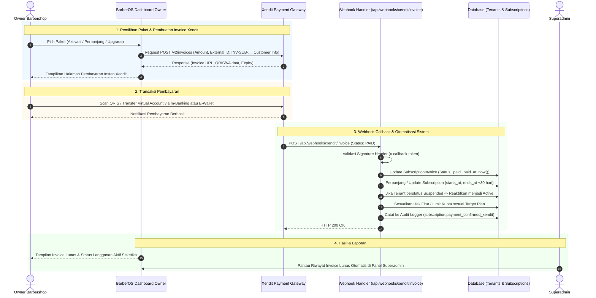

# PLAN-XENDIT-SUBSCRIPTION-PAYMENT.md — Rencana Integrasi Pembayaran Langganan SaaS Otomatis Menggunakan Xendit

> **Status:** Draft / Planned  
> **Tujuan:** Mengganti alur pembayaran paket langganan barbershop (SaaS Subscription) dari transfer manual dan unggah bukti struk menjadi **otomatis 100% menggunakan Xendit (QRIS & Virtual Account)** dengan aktivasi instan 24/7 tanpa perlu verifikasi manual dari Superadmin.

---

## 1. Latar Belakang & Kebutuhan

Saat ini, pembayaran sewa software/langganan barbershop (`SubscriptionInvoice`) masih menggunakan skema **Manual Bank Transfer**:
1. Owner memilih paket (Starter, Pro, Business).
2. Sistem menerbitkan invoice dengan status `unpaid`.
3. Owner mentransfer dana ke nomor rekening bank platform secara manual.
4. Owner mengunggah foto/struk bukti transfer (`proof_path`) dan status berubah menjadi `pending`.
5. Superadmin harus memeriksa mutasi rekening bank dan menekan tombol verifikasi secara manual di Panel Superadmin untuk mengaktifkan masa aktif tenant.

### Masalah pada Skema Lama:
* **Downtime Operasional:** Jika masa langganan habis pada malam hari atau akhir pekan saat Superadmin sedang offline, barbershop akan terkunci dan tidak bisa beroperasi hingga admin memverifikasi transfer.
* **Risiko Human Error & Struk Palsu:** Verifikasi manual rawan kesalahan membaca mutasi atau kelalaian mendeteksi bukti pembayaran editan.
* **Beban Administrasi:** Superadmin harus meluangkan waktu mencocokkan nominal invoice dengan mutasi rekening satu per satu.

### Prinsip Solusi Baru (Eksklusif Xendit):
1. **Cukup Menggunakan Xendit (Tanpa Transfer Manual):**
   * Mengeliminasi form unggah bukti pembayaran struk transfer dan pilihan transfer bank manual pada tagihan langganan.
   * Seluruh pembayaran langganan dialihkan ke gateway Xendit resmi platform.
2. **Aktivasi Instan & Otomatis (24/7 Instant Activation):**
   * Begitu owner membayar via QRIS atau Virtual Account Xendit, webhook Xendit akan langsung diterima sistem detik itu juga.
   * Sistem otomatis memperpanjang masa aktif (`ends_at` +30 hari), meng-upgrade/downgrade fitur sesuai paket, dan membuka kunci operasional secara otomatis.
3. **Penanganan Paket Gratis / Rp0 (Zero-Amount Plan Bypass):**
   * Jika paket langganan (misal **Starter**) disetel seharga **Rp0 (Gratis)**:
     * Sistem **tidak memanggil API Xendit** (karena payment gateway menolak transaksi nominal 0).
     * Tagihan langsung otomatis berstatus `paid` secara seketika (*Bypass Gateway*), dan masa aktif paket langsung diberikan tanpa perlu proses bayar apa pun.
4. **Multi-Channel Pembayaran Nasional:**
   * Mendukung QRIS (BCA, Mandiri, BRI, BNI, GoPay, OVO, ShopeePay, DANA, LinkAja) serta Virtual Account bank utama.
4. **Keamanan & Idempotensi Tinggi:**
   * Validasi token webhook (`x-callback-token`).
   * Idempotensi proteksi: sinyal webhook ganda dari payment gateway tidak akan melipatgandakan masa aktif langganan.
5. **Mode Simulasi / Mock Otomatis:**
   * Di lingkungan pengembangan lokal (*local development* / testing) jika API key Xendit belum diisi, sistem menyediakan mode mock/simulasi yang dapat langsung dicoba tanpa memotong saldo nyata.
6. **White-Label & Branding Bersih (Privasi Vendor Gateway):**
   * Di seluruh antarmuka Owner/Pelanggan, tidak menampilkan atau membocorkan nama vendor gateway (seperti kata "Xendit" atau label teknis "Metode Gateway").
   * Seluruh teks antarmuka menggunakan terminologi resmi dan profesional: "Metode Pembayaran: QRIS & Virtual Account", "Pembayaran Instan Online", dan "Buka Layar Pembayaran".

---

## 2. Diagram Alur Sistem (Sequence Diagram)



---

## 3. Rincian Teknis & Perubahan Kode

### A. Database Migration: Kolom Xendit pada `subscription_invoices`
Tambahkan kolom pendukung Xendit pada tabel `subscription_invoices`:
```php
Schema::table('subscription_invoices', function (Blueprint $table): void {
    $table->string('xendit_invoice_id')->nullable()->after('gateway_ref')->index();
    $table->string('xendit_external_id')->nullable()->after('xendit_invoice_id')->index();
    $table->text('xendit_payment_url')->nullable()->after('xendit_external_id');
    $table->string('xendit_payment_method', 50)->nullable()->after('xendit_payment_url');
    $table->string('xendit_payment_channel', 50)->nullable()->after('xendit_payment_method');
    $table->dateTime('xendit_paid_at')->nullable()->after('xendit_payment_channel');
    $table->dateTime('xendit_expired_at')->nullable()->after('xendit_paid_at');
});
```

### B. Service Layer: Ekspansi `XenditPaymentService`
Tambahkan fungsi khusus untuk menangani invoice langganan:
1. `createSubscriptionInvoice(SubscriptionInvoice $invoice): array`:
   * Mengirim request ke endpoint Xendit `POST /v2/invoices`.
   * Mengisi `external_id` berformat: `BOS-SUB-{$invoice->number}-{$invoice->id}`.
   * Nominal tagihan (`amount`) sesuai harga paket target.
   * `description`: `"Langganan Paket {$plan->name} - {$tenant->name}"`.
   * `customer`: data nama owner & email/nomor telepon.
   * `success_redirect_url` & `failure_redirect_url`: kembali ke rute `owner.subscription.invoice`.
   * Mendukung mode fallback mock otomatis jika API key belum diset.
2. `getOrCreateSubscriptionInvoice(SubscriptionInvoice $invoice): array`:
   * Menggunakan kembali URL/invoice Xendit yang sudah ada jika masih aktif dan belum kedaluwarsa.

### C. Service Layer: `SubscriptionActivationService`
Ekstrak logika pengaktifan langganan dari `PlatformSubscriptionController` ke dalam sebuah service reusable (`SubscriptionActivationService`):
* Menghitung tanggal `period_start` dan `period_end` (perpanjangan 30 hari jika renewal, atau 30 hari dari sekarang jika upgrade/baru).
* Mengubah status `SubscriptionInvoice` menjadi `paid`.
* Mengupdate / membuat record `Subscription`.
* Menyesuaikan batasan paket tenant (`resetPlanRestrictedFeatures`).
* Membuka blokir tenant jika status sebelumnya `Suspended`.
* Mencatat audit log transaksi.
* *Service ini dapat dipanggil secara otomatis oleh Webhook Xendit, maupun secara manual oleh Superadmin jika dibutuhkan.*

### D. Webhook Controller: `XenditWebhookController`
Perluas method `handleInvoice` di `app/Http/Controllers/Api/XenditWebhookController.php`:
* Periksa format `external_id`:
  * Jika berawalan `BOS-BK-...`: diproses sebagai pembayaran **Booking Pelanggan** (alur eksisting).
  * Jika berawalan `BOS-SUB-...` atau `INV-SUB-...`: diproses sebagai pembayaran **Langganan SaaS Barbershop**.
* Jika `status == 'PAID'`:
  * Cari `SubscriptionInvoice` terkait.
  * Cek idempotensi: jika invoice sudah `paid`, return response sukses tanpa proses ulang.
  * Panggil `SubscriptionActivationService::activateFromInvoice($invoice, $payload)`.
  * Return response JSON `200 OK`.

### E. Controller & Tampilan Owner
1. **`OwnerManagementController`**:
   * Saat memproses `upgradeSubscription`:
     * **Jika Paket Rp0 (Gratis/Starter):** Sistem langsung mengeksekusi `SubscriptionActivationService`, menandai invoice `paid` dengan gateway `free_tier`, dan mengarahkan kembali ke dashboard owner dengan pesan *"Paket Gratis berhasil diaktifkan!"* tanpa membuka gateway Xendit.
     * **Jika Paket Berbayar (> Rp0):** Panggil `XenditPaymentService::createSubscriptionInvoice($invoice)` dan arahkan ke halaman invoice dengan link pembayaran Xendit.
   * Hapus rute submit bukti manual `submitPaymentProof` (atau nonaktifkan formnya).
2. **`resources/views/owner/subscription-invoice.blade.php`**:
   * **Hapus Total:** Form upload file bukti transfer struk gambar, radio box rekening bank manual, dan instruksi transfer manual.
   * **Ganti Dengan:**
     * Komponen **"Bayar Instan dengan Xendit"** yang menampilkan rincian tagihan, logo metode pembayaran yang didukung (QRIS & Virtual Account), batas waktu pembayaran (*countdown timer*), dan tombol aksi utama **"Bayar Tagihan Sekarang (Buka Pembayaran)"**.
     * QRIS interaktif / iframe checkout jika diakses langsung di desktop/mobile.
     * Polling status sederhana / auto-refresh saat halaman terbuka agar ketika pembayaran selesai via smartphone, halaman langsung berubah menjadi hijau (*Lunas*).

### F. Tampilan Superadmin (`resources/views/platform/subscriptions.blade.php`)
* Tagihan yang dibayar via Xendit diberi badge elegan `Lunas via Xendit (Otomatis)`.
* Menampilkan Channel Pembayaran (misal: `QRIS`, `BCA VA`, dll) dan ID Transaksi Xendit.
* Tombol verifikasi manual tetap dipertahankan bagi Superadmin hanya sebagai opsi *override* darurat.

---

## 4. Rencana Pengujian (Test Plan)

| No | Skenario Uji | Ekspektasi Hasil |
| :--- | :--- | :--- |
| 1 | Owner memilih paket Starter/Pro/Business | Invoice terbit, field Xendit terisi, URL invoice Xendit siap |
| 2 | Owner membuka halaman invoice | Tampil tombol bayar Xendit, tidak ada form upload struk |
| 3 | Webhook Xendit mengirim payload `PAID` valid | Status invoice berubah `paid`, masa aktif `Subscription` bertambah +30 hari, tenant aktif |
| 4 | Webhook Xendit mengirim callback berulang (duplikat) | Sistem mengenali invoice sudah lunas (idempoten), tidak ada penambahan masa aktif berlebih |
| 5 | Webhook mengirim token `x-callback-token` yang salah | Request ditolak dengan kode respon HTTP 401 Unauthorized |
| 6 | Simulasi offline / local mock | Halaman invoice dapat disimulasikan lunas via tombol simulasi lokal tanpa error |

---

## 5. Tahapan Eksekusi (Implementation Steps)

1. [ ] **Step 1:** Buat file migration untuk menambahkan kolom-kolom Xendit pada tabel `subscription_invoices`.
2. [ ] **Step 2:** Perbarui model `SubscriptionInvoice` (`$fillable`, `$casts`, helper methods).
3. [ ] **Step 3:** Buat / lengkapi `SubscriptionActivationService` untuk enkapsulasi logika aktivasi langganan.
4. [ ] **Step 4:** Tambahkan method `createSubscriptionInvoice()` dan `getOrCreateSubscriptionInvoice()` pada `XenditPaymentService`.
5. [ ] **Step 5:** Perbarui `XenditWebhookController` untuk mengenali dan mengeksekusi aktivasi pembayaran langganan saat status `PAID`.
6. [ ] **Step 6:** Modifikasi `OwnerManagementController` dan view `resources/views/owner/subscription-invoice.blade.php` (menghapus form upload struk, mengganti dengan antarmuka pembayaran Xendit instan).
7. [ ] **Step 7:** Buat automated Feature Test (`tests/Feature/SubscriptionXenditPaymentTest.php`) untuk memverifikasi seluruh alur dari invoice dibuat hingga aktivasi via webhook.
8. [ ] **Step 8:** Lakukan pengujian end-to-end, verifikasi tidak ada regresi pada fitur booking Xendit yang sudah berjalan.
