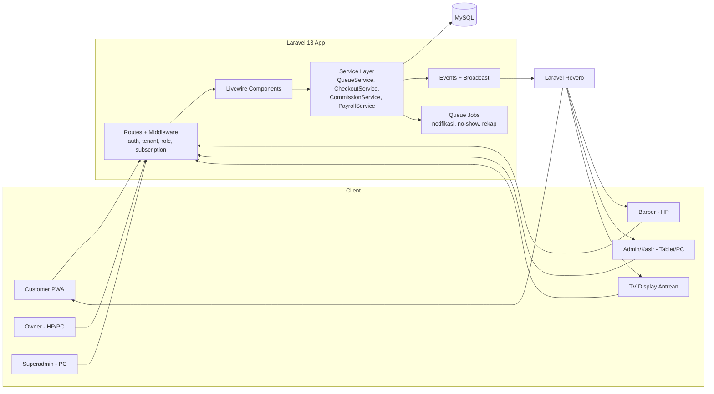
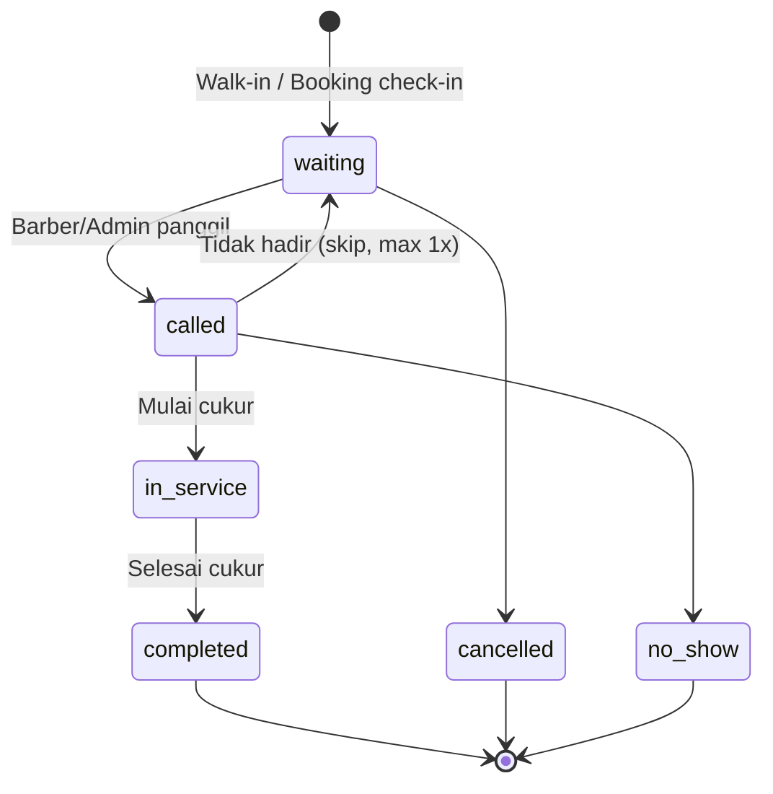
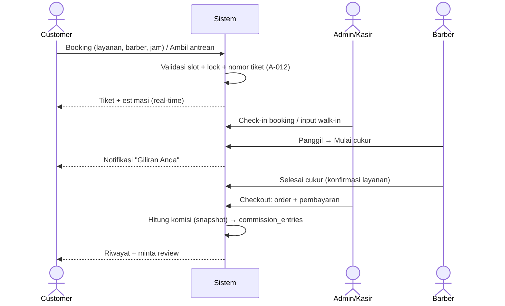

# PLANS.md — Rencana Pembuatan Barbershop SaaS

> Dokumen ini adalah rencana kerja pengembangan platform **Barbershop SaaS** (multi-tenant).
> Desain UI ada di [`DESIGN.md`](./DESIGN.md), skema database ada di [`DATABASE.md`](./DATABASE.md).
> Rencana fitur operasional harian (Kasir, Barber, Customer) ada di [`PLAN-KASIR-BARBER-CUSTOMER.md`](./PLAN-KASIR-BARBER-CUSTOMER.md).
> Rencana integrasi pembayaran gateway Xendit & pencairan escrow Superadmin ada di [`PLAN-XENDIT-ESCROW-BOOKING.md`](./PLAN-XENDIT-ESCROW-BOOKING.md).
> Rencana integrasi pembayaran langganan SaaS otomatis via Xendit ada di [`PLAN-XENDIT-SUBSCRIPTION-PAYMENT.md`](./PLAN-XENDIT-SUBSCRIPTION-PAYMENT.md).
> Rencana sistem saldo dompet refund customer & penarikan dana escrow ada di [`PLAN-CUSTOMER-REFUND-WALLET-ESCROW.md`](./PLAN-CUSTOMER-REFUND-WALLET-ESCROW.md).

---

## 1. Ringkasan Produk

Satu platform web (responsif + PWA) yang disewakan ke banyak barbershop. Setiap barbershop (tenant) memiliki outlet, karyawan, layanan, harga, antrean, transaksi, payroll, dan pelanggan sendiri yang **terisolasi** satu sama lain.

| Modul | Isi |
|---|---|
| Platform (Superadmin) | Tenant, paket langganan, monitoring, konfigurasi |
| Barbershop Management (Owner/Admin) | Outlet, karyawan, layanan, antrean, kasir, laporan, payroll |
| Barber App (Staff) | Antrean pribadi, mulai/selesai cukur, penghasilan, jadwal |
| Customer App | Booking, ambil antrean, status real-time, riwayat, review |

---

## 2. Keputusan Awal (Asumsi Default)

> [!NOTE]
> Keputusan di bawah adalah default yang disarankan. Bisa diubah sebelum Tahap 1 dimulai.

| # | Topik | Keputusan default |
|---|---|---|
| 1 | Bentuk produk | Satu platform SaaS multi-barbershop, white-label ringan (logo, warna, nama) |
| 2 | Akses customer | Website responsif + PWA (installable) |
| 3 | Pembayaran customer | Dibayar langsung ke barbershop (tunai / QRIS milik outlet / transfer), dicatat kasir |
| 4 | Frontend | **Livewire 3 + Alpine.js + Tailwind CSS 4** |
| 5 | Panel Superadmin | Livewire custom (opsional Filament di Tahap 4) |
| 6 | Multi-tenancy | Single database, kolom `tenant_id` + Global Scope + Policy |
| 7 | URL tenant | Path-based: `app.test/{tenant_slug}` untuk customer; dashboard di `app.test/dashboard` (tenant aktif dari sesi). Subdomain di Tahap 4 |
| 8 | Login staff | Email/username + password |
| 9 | Login customer | Nomor HP + password / Google login (MVP); OTP WhatsApp di Tahap 3 |
| 10 | Antrean | **Digabung** per cabang: booking yang sudah check-in disisipkan berdasarkan jam booking; walk-in mengikuti urutan |
| 11 | Toleransi telat booking | 15 menit (dapat diatur per cabang), lewat itu → `no_show` atau turun ke antrean walk-in |
| 12 | Pilih barber | Customer boleh pilih barber **atau** "Siapa saja (tercepat)" |
| 13 | Real-time | Laravel Reverb (WebSocket), fallback polling `wire:poll` 10 detik |
| 14 | Database | MySQL 8 (Laragon). Kompatibel PostgreSQL |
| 15 | Bahasa & zona waktu | Bahasa Indonesia, `Asia/Jakarta`, mata uang IDR (integer, tanpa desimal) |

---

## 3. Arsitektur Teknis



### Prinsip teknis wajib
1. **Isolasi tenant**: semua model bisnis memakai trait `BelongsToTenant` (global scope `tenant_id` + auto-fill saat create).
2. **Isolasi cabang**: data operasional (antrean, transaksi, absensi) memiliki `branch_id`; user hanya bisa akses cabang yang ada di `memberships`.
3. **Otorisasi server-side**: Policy + Gate per role (bukan hanya menyembunyikan menu).
4. **Konsistensi antrean**: `DB::transaction()` + `lockForUpdate()` saat membuat nomor antrean & saat barber mengambil tiket; kolom `version`/status-check untuk optimistic locking.
5. **Idempotensi**: kolom `idempotency_key` unik di `orders` & `payments` untuk mencegah submit ganda.
6. **Snapshot**: harga, durasi, dan aturan komisi disalin ke `order_items` saat transaksi dibuat.
7. **Audit log**: perubahan pada transaksi, refund, booking, payroll, harga, dan pengaturan dicatat.
8. **Uang** disimpan sebagai `unsignedBigInteger` (rupiah penuh).
9. **Status layanan dan status pembayaran dipisah**.

### Struktur folder (rencana)
```
app/
├── Enums/            # Role, QueueStatus, BookingStatus, PaymentStatus, PaymentMethod, ...
├── Models/
│   └── Concerns/BelongsToTenant.php
├── Http/Middleware/  # SetCurrentTenant, EnsureRole, EnsureActiveSubscription
├── Livewire/
│   ├── Platform/     # Superadmin
│   ├── Owner/
│   ├── Cashier/
│   ├── Barber/
│   └── Customer/
├── Services/         # QueueService, BookingService, CheckoutService, CommissionService, PayrollService
├── Policies/
├── Events/           # QueueTicketUpdated, BookingCreated, ...
└── Support/Tenancy/  # CurrentTenant (singleton)
resources/views/
├── layouts/          # app-sidebar, app-mobile, customer, guest, display
└── components/ui/    # button, card, badge, stat, modal, bottom-sheet, ...
```

---

## 4. Role & Hak Akses (RBAC)

| Fitur | Superadmin | Owner | Admin/Kasir | Barber | Customer |
|---|:-:|:-:|:-:|:-:|:-:|
| Kelola tenant & paket | ✅ | – | – | – | – |
| Dashboard omzet tenant | 👁 (agregat) | ✅ | 🔸 shift sendiri | – | – |
| Kelola cabang | – | ✅ | – | – | – |
| Kelola karyawan | – | ✅ | – | – | – |
| Layanan & harga | – | ✅ | 👁 | 👁 | 👁 |
| Antrean & booking | – | ✅ | ✅ | 🔸 miliknya | 🔸 miliknya |
| Mulai / selesai cukur | – | ✅ | ✅ | ✅ | – |
| Pembayaran / kasir | – | ✅ | ✅ | – | – |
| Batal / refund | – | ✅ | 🔸 jika diizinkan | – | 🔸 batal booking sendiri |
| Komisi & payroll | – | ✅ | – | 👁 miliknya | – |
| Absensi | – | ✅ | ✅ (cabangnya) | 🔸 check-in sendiri | – |
| Laporan | 👁 platform | ✅ | 🔸 shift | 🔸 pribadi | – |
| Review | – | 👁 | 👁 | 👁 miliknya | ✅ |

✅ penuh · 🔸 terbatas · 👁 lihat saja

> Satu user dapat memiliki beberapa membership (mis. Owner di tenant A, Barber di tenant B). Customer adalah user global yang bisa berkunjung ke banyak tenant.

---

## 5. Alur Inti

### 5.1 Status antrean (layanan)


### 5.2 Status booking
`pending` → `confirmed` → `checked_in` (membuat `queue_ticket`) → selesai mengikuti tiket.
Cabang: `cancelled`, `no_show`, `expired`.

### 5.3 Status pembayaran (terpisah dari layanan)
`unpaid` → `paid` → (`partially_refunded` | `refunded`). Juga `void` untuk order batal sebelum bayar.

### 5.4 Alur end-to-end


### 5.5 Aturan komisi
- Komisi dibuat **hanya** jika `queue_ticket.status = completed` **dan** `order.payment_status = paid`.
- Basis default: harga jasa **setelah diskon**, **tidak termasuk tip**. Tip 100% untuk barber (dicatat terpisah).
- Refund → membuat `commission_entries` negatif (reversal), bukan menghapus.
- Payroll yang sudah `closed` tidak bisa diubah; koreksi masuk periode berikutnya sebagai adjustment.

### 5.6 Estimasi waktu tunggu
`estimasi = sisa durasi layanan yang berjalan + Σ durasi tiket di depan (untuk barber terpilih)`. Untuk "siapa saja", gunakan barber dengan beban paling kecil. Ditampilkan sebagai perkiraan.

---

## 6. Tahapan Pengembangan

> Estimasi untuk 1 developer full-time. Setiap tahap diakhiri dengan pengujian (Pest/PHPUnit) dan demo.

### Tahap 0 — Fondasi (± 3–4 hari) ✅ SELESAI
- [x] Install Laravel Boost (`composer require laravel/boost --dev`, `php artisan boost:install`)
- [x] Install Livewire, Alpine, Tailwind CSS 4
- [x] Konfigurasi `.env` & `config/app.php` (MySQL `barberdb`, `APP_TIMEZONE=Asia/Jakarta`, `APP_LOCALE=id`)
- [x] Design system: token warna Charcoal & Gold, font, komponen Blade UI dasar (`button`, `card`, `stat`, `badge`, `input`, `empty-state`)
- [x] Layout: `guest`, `app` (sidebar desktop + bottom nav mobile), `customer`, `display`
- [x] Autentikasi (login email/no HP, logout, redirect otomatis per role)
- [x] Trait `BelongsToTenant`, middleware `SetCurrentTenant` & `EnsureRole`, Enum role & status
- [x] Seeder demo terpisah: `PlanSeeder`, `SuperAdminSeeder`, `OwnerSeeder`, `StaffAndBarberSeeder`, `ServiceAndCommissionSeeder`, `OperationalDemoSeeder`

### Tahap 1 — MVP Operasional (± 3–4 minggu) ✅ SELESAI
**Minggu 1 – Tenant & master data**
- [x] Superadmin: CRUD tenant, aktif/nonaktif (suspend), paket dasar (`/platform`)
- [x] Owner: profil barbershop, CRUD cabang (jam buka, toleransi telat) (`/owner/branches`)
- [x] Owner: CRUD karyawan + membership (role & cabang) (`/owner/staff`)
- [x] Owner: kategori & layanan (harga, durasi), update harga dengan snapshot protection (`/owner/services`)
- [x] Policy & middleware role + tenant scoped validation untuk seluruh route

**Minggu 2 – Antrean & booking**
- [x] `QueueService`: buat tiket walk-in (nomor per cabang per hari, prefix A/B), `lockForUpdate` & transaksi
- [x] `BookingService`: cek slot bentrok berdasarkan jadwal barber + durasi + booking lain
- [x] Customer: pilih layanan → barber → tanggal & jam → konfirmasi (`/b/{tenant}`)
- [x] Customer: ambil antrean langsung (`/b/{tenant}`)
- [x] Admin: papan antrean (Kanban), check-in booking, panggil/mulai/selesai (`/cashier`)
- [x] Barber: daftar antrean, tombol Panggil / Mulai / Selesai (`/barber`)
- [x] Halaman TV Display antrean (`/b/{tenant}/tv/{branchCode}`)

**Minggu 3 – Kasir & transaksi**
- [x] `CheckoutService`: order dari tiket, diskon, tip, snapshot harga & aturan komisi
- [x] Pembayaran: tunai (kembalian), QRIS, transfer
- [x] Idempotency key untuk mencegah double payment
- [x] Refund (dengan alasan) + reversal komisi negatif + audit log (`/owner/reports`)
- [x] Pencatatan kas otomatis pada shift kasir aktif

**Minggu 4 – Dashboard & polish**
- [x] Dashboard Owner: omzet, customer, booking aktif, barber aktif, transaksi terbaru (`/owner`)
- [x] Dashboard Admin: papan antrean hari ini, check-in booking, kasir (`/cashier`)
- [x] Dashboard Barber: dilayani hari ini, komisi hari ini, antrean kursi (`/barber`)
- [x] Laporan transaksi (filter cabang) + export CSV + Audit log viewer (`/owner/reports`)
- [x] Uji otomatis: isolasi lintas tenant, race condition/sequential nomor antrean, validasi slot bentrok, double payment idempotency, snapshot harga & reversal refund (`Phase1OperationalMvpTest`)

**Deliverable**: barbershop dapat beroperasi penuh harian (booking, walk-in, antrean, kasir, laporan dasar).

### Tahap 2 — Barber & Payroll (± 2–3 minggu)
- [ ] Jadwal kerja barber (shift mingguan, libur, cuti) → dipakai validasi slot booking
- [ ] Absensi: check-in/out (opsional geolokasi radius cabang / foto selfie)
- [ ] Skema komisi: flat per layanan, persentase, per layanan tertentu, override per barber
- [ ] `CommissionService` + `commission_entries` (termasuk reversal)
- [ ] Skema gaji: pokok, komisi, pokok+komisi, bonus target (bertingkat)
- [ ] Payroll: buat periode → generate draft → review → approve Owner → tutup → tandai dibayar
- [ ] Bonus & potongan manual (kasbon, denda telat) dengan alasan
- [ ] Slip gaji (PDF) + riwayat pembayaran
- [ ] Halaman Penghasilan Barber: hari/minggu/bulan, komisi, bonus, potongan, dibayar vs belum
- [ ] Laporan kinerja barber (Owner)

### Tahap 3 — Customer Experience (± 2–3 minggu)
- [ ] PWA: manifest, ikon, service worker, install prompt
- [ ] QR code per cabang (cetak poster) → langsung ke halaman ambil antrean
- [ ] Login OTP WhatsApp (provider: Fonnte/Wablas/Qontak, dsb.)
- [ ] Notifikasi: Web Push + WhatsApp ("2 antrean lagi", "Giliran Anda", pengingat booking H-1/H-1jam)
- [ ] Riwayat cukur (layanan, barber, foto hasil opsional, catatan gaya)
- [ ] Rating & review per kunjungan (moderasi Owner)
- [ ] Membership / poin loyalitas, voucher & promo
- [ ] Halaman publik outlet (profil, layanan, barber, review, peta)

### Tahap 4 — SaaS Komersial (± 3–4 minggu)
- [ ] Self-service onboarding tenant (daftar → trial 14 hari → wizard setup)
- [ ] Paket & limit fitur (outlet, staff, payroll, branding) — `plan_features`
- [ ] Tagihan langganan + payment gateway (Midtrans/Xendit) + webhook
- [ ] Grace period, auto-suspend, perpanjangan, upgrade/downgrade
- [ ] White-label: logo, warna, subdomain `{slug}.domain.com`, custom domain (Enterprise)
- [ ] Dashboard platform: MRR, tenant aktif, churn, transaksi semua tenant
- [ ] Tiket komplain / support
- [ ] Backup, monitoring (Sentry), rate limiting, hardening

---

## 7. Paket Langganan (Draft)

| Paket | Harga/bulan | Outlet | Staff | Payroll | Branding | Notifikasi WA |
|---|---|---|---|---|---|---|
| Starter | Rp99.000 | 1 | 5 | Dasar (komisi) | Logo | – |
| Pro | Rp249.000 | 3 | 20 | Lengkap | Logo + warna | ✅ |
| Business | Rp499.000 | 10 | Tak terbatas | Lengkap + slip | Subdomain | ✅ |

> Harga adalah hipotesis awal untuk uji pasar.

---

## 8. Strategi Pengujian

| Jenis | Fokus |
|---|---|
| Feature test | Isolasi tenant (user tenant A tidak bisa akses data B — tiap endpoint) |
| Feature test | Otorisasi per role |
| Concurrency test | Dua request ambil tiket/nomor bersamaan → nomor unik; dua barber ambil tiket yang sama → hanya satu berhasil |
| Unit test | Kalkulasi komisi, payroll, estimasi antrean, slot booking |
| Browser test (opsional) | Alur booking customer di viewport mobile |

---

## 9. Risiko & Mitigasi

| Risiko | Mitigasi |
|---|---|
| Kebocoran data antar tenant | Global scope wajib + test otomatis per model + Policy |
| Nomor antrean ganda | Tabel `queue_counters` + `lockForUpdate` dalam transaksi |
| Komisi tidak sesuai setelah ubah harga | Snapshot harga & aturan di `order_items` |
| Real-time gagal (jaringan HP) | Fallback polling + tombol refresh |
| Aturan ketenagakerjaan | Sistem hanya alat hitung; Owner bertanggung jawab atas kepatuhan UMR/lembur — tampilkan disclaimer |
| Scope creep | Kerjakan per tahap, fitur baru masuk backlog |

---

## 10. Definition of Done per Fitur
- Kode lolos `pint`, test hijau
- Policy/otorisasi ada & teruji
- Tampilan dicek di viewport 375px dan 1280px
- Aksi penting tercatat di audit log
- Empty state, loading state, error state tersedia
