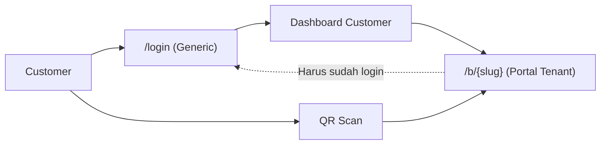
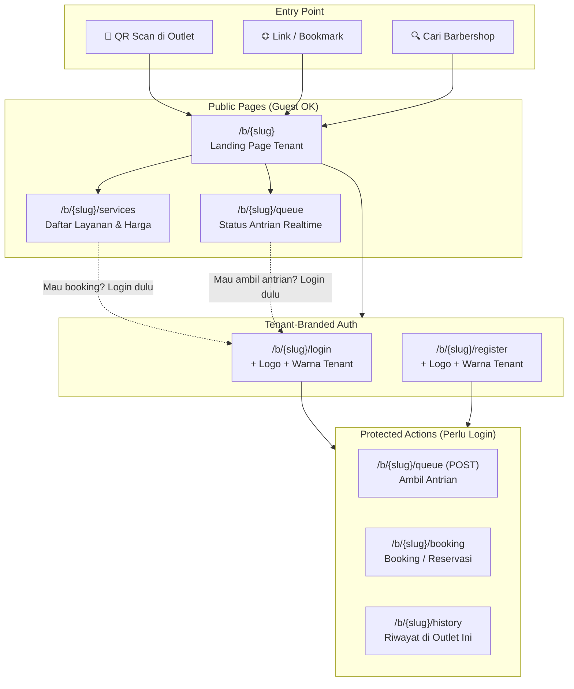

# 🏗️ Arsitektur Login & Booking Customer — Rekomendasi

> [!IMPORTANT]
> Dokumen ini merangkum opsi dan rekomendasi arsitektur untuk alur login, registrasi, dan booking customer di sistem multi-tenant barbershop.

---

## Masalah Saat Ini



| Masalah | Dampak |
|---------|--------|
| Login page (`/login`) **generik** — tanpa branding tenant | Kalau ada fitur Pro (custom logo, warna), customer tetap lihat halaman default |
| Portal `/b/{slug}` butuh **middleware `role:customer`** (harus login dulu) | Customer baru yang scan QR langsung ditolak ke `/login` yang generik |
| Booking bisa lewat `/b/{slug}/booking` atau `/customer/booking` — **dua jalur** | Membingungkan dan sulit di-brand |

---

## Rekomendasi: Tenant-Scoped Auth + Guest Browsing

### Prinsip Utama

1. **URL = Konteks Tenant** — Semua halaman publik customer selalu di bawah `/b/{slug}/...`
2. **Guest bisa browsing** — Lihat layanan, harga, antrian, barber tersedia **tanpa login**
3. **Login/Register per tenant** — `/b/{slug}/login` dan `/b/{slug}/register` menampilkan branding tenant
4. **Satu akun universal** — Akun user tidak terikat ke satu tenant, bisa kunjungi outlet mana saja

### Alur Baru



---

## Detail Struktur Route

### Sebelum (Current)
```php
// Generic auth — tanpa tenant context
Route::middleware('guest')->group(function () {
    Route::get('/login', ...);        // ← Generik
    Route::get('/register', ...);     // ← Generik
});

// Portal butuh login
Route::middleware('role:customer')->group(function () {
    Route::get('/b/{tenant}', ...);   // ← Harus sudah login
});
```

### Sesudah (Proposed)

```php
// ============================================
// TENANT-SCOPED PUBLIC (Guest bisa akses)
// ============================================
Route::prefix('b/{tenant}')->group(function () {
    // Landing page — tampil info tenant, layanan, antrian
    Route::get('/', [CustomerPortalController::class, 'landing'])
        ->name('tenant.landing');

    // Auth per tenant (branded)
    Route::middleware('guest')->group(function () {
        Route::get('/login', [TenantAuthController::class, 'showLogin'])
            ->name('tenant.login');
        Route::post('/login', [TenantAuthController::class, 'login'])
            ->name('tenant.login.store');
        Route::get('/register', [TenantAuthController::class, 'showRegister'])
            ->name('tenant.register');
        Route::post('/register', [TenantAuthController::class, 'register'])
            ->name('tenant.register.store');
    });

    // Protected customer actions di tenant ini
    Route::middleware('auth')->group(function () {
        Route::post('/queue', ...)->name('tenant.queue.store');
        Route::get('/booking', ...)->name('tenant.booking');
        Route::post('/booking', ...)->name('tenant.booking.store');
        Route::get('/history', ...)->name('tenant.history');
    });

    // TV Display (publik, tanpa auth)
    Route::get('/tv/{branchCode}', ...)->name('tenant.tv');
});

// ============================================
// GENERIC AUTH (untuk staff: owner/admin/barber)
// ============================================
Route::middleware('guest')->group(function () {
    Route::get('/login', ...)->name('login');       // Staff only
    Route::get('/register', ...)->name('register'); // Staff only
});

// ============================================
// PERSONAL CUSTOMER PAGES (cross-tenant)
// ============================================
Route::middleware('auth')->prefix('customer')->group(function () {
    Route::get('/', ...)->name('customer.dashboard');     // Overview semua tenant
    Route::get('/history', ...)->name('customer.history'); // Semua riwayat
    Route::get('/profile', ...)->name('customer.profile');
});
```

---

## Bagaimana Branding Bekerja

### Controller: `TenantAuthController`

```php
class TenantAuthController extends Controller
{
    public function showLogin(string $tenantSlug)
    {
        $tenant = Tenant::where('slug', $tenantSlug)->firstOrFail();
        
        return view('tenant.auth.login', [
            'tenant' => $tenant,
            // View akan pakai: $tenant->name, $tenant->logo_path, 
            // $tenant->brand_color untuk styling
        ]);
    }

    public function login(LoginRequest $request, string $tenantSlug)
    {
        // Login logic sama (satu tabel user)
        // Setelah berhasil, redirect ke /b/{slug} (portal tenant)
        // Simpan tenant context di session
    }
}
```

### View: `tenant/auth/login.blade.php`

```html
<!-- Halaman login dengan branding tenant -->
<div style="--brand-color: {{ $tenant->brand_color ?? '#4F46E5' }}">
    logo_path }}" alt="{{ $tenant->name }}">
    <h1>Masuk ke {{ $tenant->name }}</h1>
    
    <!-- Form login (email/phone + password) -->
    <!-- Tombol: background mengikuti brand_color -->
</div>
```

---

## Alur Per Skenario

### 1. 📱 Customer Scan QR di Outlet
```
QR Code berisi: https://barberos.app/b/barber-king?branch=SDR

→ /b/barber-king (Landing Page — Guest OK ✓)
→ Lihat antrian, layanan, harga
→ Klik "Ambil Antrian" 
→ Belum login? Redirect ke /b/barber-king/login (BRANDED ✓)
→ Login/Register
→ Redirect balik ke aksi yang diminta
```

### 2. 🌐 Customer Booking Langsung (Tanpa QR)
```
Customer punya link: https://barberos.app/b/barber-king

→ /b/barber-king (Landing Page — Guest OK ✓)
→ Klik "Booking / Reservasi"
→ /b/barber-king/login (BRANDED ✓) atau langsung jika sudah login
→ /b/barber-king/booking
→ Pilih cabang, layanan, tanggal, barber
→ Konfirmasi booking
```

### 3. 🏢 Customer dengan Multiple Outlet
```
Customer A → Scan QR di "Barber King" → /b/barber-king
Customer A → Scan QR di "Razor House" → /b/razor-house (akun SAMA ✓)

Dashboard personal: /customer/ → Lihat riwayat dari SEMUA outlet
```

---

## Landing Page Tenant (Guest-Accessible)

> [!TIP]
> Halaman ini adalah "etalase digital" barbershop — harus menarik dan informatif tanpa harus login.

### Konten yang ditampilkan (tanpa login):
- **Header**: Logo + nama barbershop + brand color
- **Info**: Alamat, jam operasional, kontak
- **Layanan & Harga**: Daftar lengkap
- **Antrian Saat Ini**: Status realtime per cabang
- **Barber Tersedia**: Siapa yang sedang bertugas
- **CTA**: "Ambil Antrian Sekarang" / "Booking Jadwal" → redirect ke login jika belum

### Konten tambahan setelah login:
- **Riwayat** kunjungan di outlet ini
- **Booking** yang sedang berjalan
- **Status tiket** antrian aktif

---

## Pro Features (Masa Depan)

| Fitur | Free | Pro |
|-------|------|-----|
| Landing page tenant | Template default | Custom tema, warna, layout |
| Logo di login page | ✓ (basic) | ✓ (full branding, favicon) |
| Custom domain | — | `barbershop.com` → `/b/{slug}` |
| Remove "Powered by BarberOS" | — | ✓ |
| Custom color scheme | 1 brand color | Full palette customization |

> [!NOTE]
> Arsitektur ini **sudah siap** untuk fitur Pro tanpa perlu refactor besar. Custom domain cukup ditangani di level web server (reverse proxy) yang memetakan domain ke slug tenant.

---

## Keputusan yang Perlu Diambil

1. **Apakah `/login` generik tetap dipertahankan untuk staff (owner/admin/barber)?**
   - Rekomendasi: **Ya** — staff login lewat `/login` biasa, customer lewat `/b/{slug}/login`
   
2. **Apakah customer bisa register tanpa konteks tenant?**
   - Rekomendasi: **Tidak** — customer selalu register lewat `/b/{slug}/register` sehingga kita tahu dari outlet mana mereka datang (berguna untuk analytics)

3. **Guest browsing — seberapa banyak info yang terbuka?**
   - Rekomendasi: **Semua info baca (layanan, harga, antrian)** terbuka, aksi (booking, ambil antrian) butuh login

4. **Redirect flow — setelah login di `/b/{slug}/login`, ke mana?**
   - Rekomendasi: Ke **intended URL** (URL yang diminta sebelumnya) atau fallback ke `/b/{slug}`
